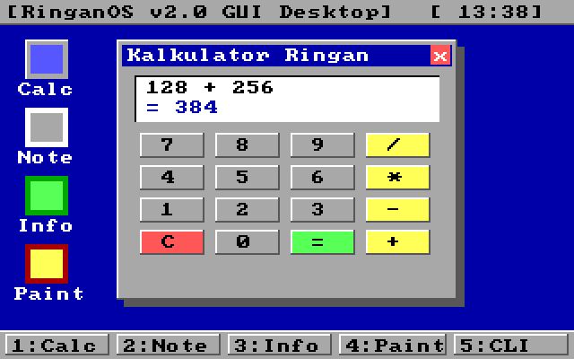
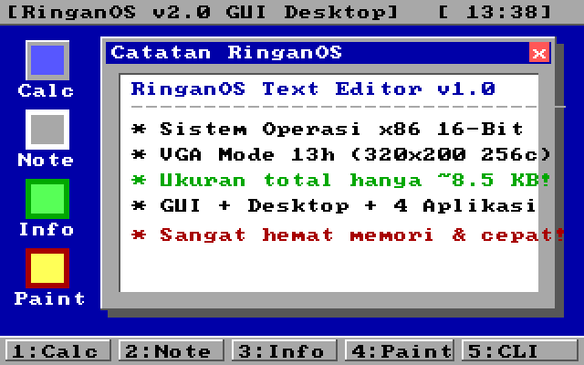
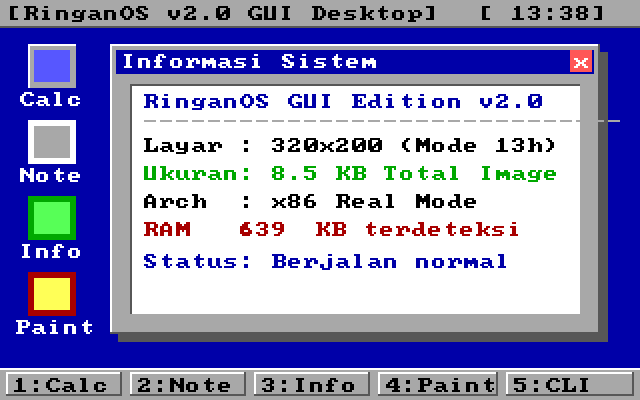
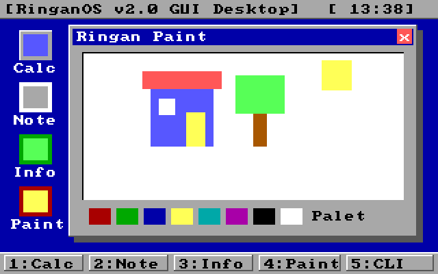
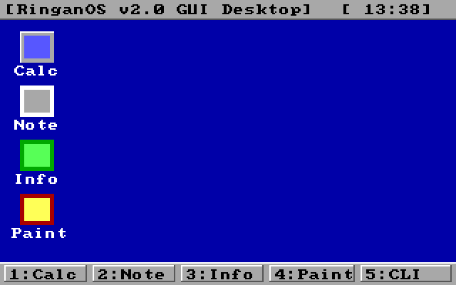
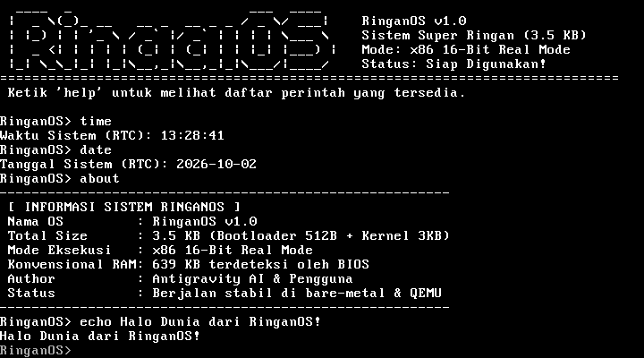

# 🖥️ RinganOS v2.0 - GUI Edition (8.5 KB)

[](https://en.wikipedia.org/wiki/Real_mode)
[](#-spesifikasi--ukuran)
[-orange.svg)](https://en.wikipedia.org/wiki/Mode_13h)

**RinganOS** adalah sistem operasi mandiri (*standalone operating system*) ultra ringan berbasis **x86 16-Bit Real Mode** yang ditulis dengan bahasa Assembly murni (*pure NASM assembly*). 

Meskipun dilengkapi dengan **Graphical User Interface (GUI) 256-warna**, sistem windowing bergaya retro 3D, jam hardware real-time, **4 aplikasi bawaan mandiri**, serta konsol CLI interaktif, ukuran total disk image hanya **8.704 byte (~8.5 KB)**!

---

## 📸 Tangkapan Layar (Screenshots di QEMU)

| Kalkulator | Catatan (Notepad) |
|:---:|:---:|
|  |  |

| Informasi Sistem | Mini Paint |
|:---:|:---:|
|  |  |

| Desktop Bersih & Ikon | Terminal CLI Shell |
|:---:|:---:|
|  |  |

---

## 📊 Spesifikasi & Ukuran

| Komponen | Berkas | Ukuran | Deskripsi |
| :--- | :--- | :--- | :--- |
| **Stage 1 Bootloader** | [`boot.asm`](boot.asm) | **512 Byte** | Sektor MBR mandiri dengan signature `0xAA55`, memuat sektor kernel via BIOS INT 13h |
| **Grafis & Windowing** | [`gui.asm`](gui.asm) | Termasuk di kernel | Driver VGA Mode 13h (320x200 256c), font piksel ROM BIOS, jendela 3D, tombol 3D |
| **Aplikasi Bawaan** | [`apps.asm`](apps.asm) | Termasuk di kernel | Logika & rendering Kalkulator, Catatan, Info Sistem, dan Paint |
| **Kernel & Shell** | [`kernel.asm`](kernel.asm) | **8.192 Byte (8 KB)** | Event loop GUI, shortcut dispatcher, dan fallback CLI shell |
| **Total Disk Image** | [`ringanos.img`](ringanos.img) | **8.704 Byte (8.5 KB)** | Image bootable raw siap pakai di QEMU atau bare-metal |

---

## 📱 Fitur & Aplikasi Bawaan

1. 🧮 **Kalkulator Ringan (Shortcut `1`):** Dilengkapi layar LCD digital dan keypad 3D lengkap (`0-9`, `+`, `-`, `*`, `/`, `=`, `C`).
2. 📝 **Catatan RinganOS / Notepad (Shortcut `2`):** Editor teks dokumen untuk melihat dan menulis catatan singkat.
3. ℹ️ **Informasi Sistem (Shortcut `3`):** Monitor sistem dengan deteksi kapasitas RAM konvensional live via BIOS INT 12h (**639 KB**), mode resolusi layar, dan status kernel.
4. 🎨 **Mini Paint (Shortcut `4`):** Kanvas menggambar visual lengkap dengan palet warna 8-warna.
5. 💻 **CLI Terminal (Shortcut `5`):** Beralih ke shell konsol teks 80x25. Ketik `gui` di CLI untuk kembali ke desktop kapan saja.
6. 🕒 **Jam RTC Live:** Ditampilkan pada panel status bar atas `[ HH:MM ]`.

---

## 🕹️ Navigasi Tombol

- **`1`** : Buka aplikasi **Kalkulator**
- **`2`** : Buka aplikasi **Catatan (Notepad)**
- **`3`** : Buka **Informasi Sistem**
- **`4`** : Buka **Mini Paint**
- **`5`** : Beralih ke **CLI Terminal** (ketik `gui` untuk kembali ke GUI)
- **`0`** atau **`Esc`** : Tutup jendela aktif (tampilan desktop bersih)
- **`q`** : Matikan sistem (*shutdown* via ACPI / APM)

---

## 🚀 Cara Menjalankan

### Persyaratan:
- `nasm`
- `qemu-system-x86_64` (atau `qemu-system-i386`)
- `make`

### Kompilasi & Jalankan:
```bash
git clone https://github.com/sunandar3221/RinganOS.git
cd RinganOS
make
make run
```

Atau langsung boot image mentah tanpa kompilasi:
```bash
qemu-system-x86_64 -drive format=raw,file=ringanos.img
```
